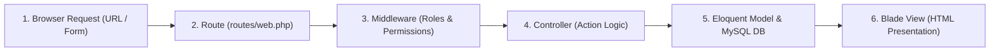

# Master Developer Guide: Building & Debugging CRUD Systems in Laravel

**Project:** Tshaprint Solutions POS & ERP  
**Target Audience:** Software Developer / System Administrator  
**Topic:** How to build, debug, and modify CRUD features independently in VS Code without AI dependency.

---

## 1. What is CRUD & Why Does it Matter?

Every business management system—whether an ERP, a POS, or an accounting package—is fundamentally built on four operations known as **CRUD**:

| Operation | Database Action (SQL) | Eloquent Method | HTTP Verb | Example in Tshaprint Solutions |
| :--- | :--- | :--- | :--- | :--- |
| **C - Create** | `INSERT INTO table` | `Model::create([...])` | `POST` | Uploading an Excel file to intake opening stock; dispatching a stock transfer. |
| **R - Read** | `SELECT * FROM table` | `Model::get()`, `::find()`, `::paginate()` | `GET` | Searching products in POS; listing stock transfers with date filters. |
| **U - Update** | `UPDATE table SET ...` | `$record->update([...])`, `->increment()` | `PUT` / `PATCH` / `POST` | Recipient clicking "Confirm Received" (status changes from `Pending` &rarr; `Received`). |
| **D - Delete** | `DELETE FROM table` | `$record->delete()`, `->forceDelete()` | `DELETE` | Removing cancelled records; soft-deleting obsolete items (`SoftDeletes`). |

---

## 2. The 5-Step Laravel Request Lifecycle

Whenever a button is clicked or a form is submitted in your browser, Laravel processes the request through five predictable layers:



### The 5 Steps in Practice:
1. **Route (`routes/web.php`):** Matches the incoming URL (e.g., `POST /transfers/{transfer}/confirm`) and directs it to the correct controller method.
2. **Middleware (`app/Http/Middleware/`):** Checks if the user is logged in (`auth`) and holds the required permission (`can:create-stock-entries`).
3. **Controller (`app/Http/Controllers/`):** Validates input data, executes the business logic, and manages database transactions.
4. **Model (`app/Models/`):** Interacts with MySQL tables using Eloquent relationships (`belongsTo`, `hasMany`).
5. **Blade View (`resources/views/`):** Renders the user interface with Tailwind CSS, Alpine.js, and dynamic PHP data.

---

## 3. Case Studies: How the New Features Were Built

### Case Study A: Fixing Repetitive Cards & Shortening SKUs (Read & Update)

#### The Problem:
- Products like *Accurate Sweater* displayed:
  ```
  Accurate Sweater
  ACCURATE-SWEATER-TRACKSUIT-22-ACCURATE-SWEATER • Size: 22 • ACCURATE SWEATER
  ```
- The SKU was 45 characters long, and the variant color tag redundantly repeated the product name three times.

#### The 5-Step Solution:
1. **Database Update (Update):**
   - We updated `sku_prefix` in the `products` table from `ACCURATE-SWEATER-TRACKSUIT` to `ACC-SW`.
   - We updated `product_variants.sku` to `ACC-SW-22` and barcode to `BC-ACC-SW-22`.
2. **Controller Logic (`app/Http/Controllers/ProductVariantController.php`):**
   - We created `generateVariantSku(Product $product, string $size, string $colour)`:
     ```php
     // Only append colour abbreviation if it is a real distinct colour (e.g., "Navy Blue" -> "-NB")
     if (!empty($normColour) && $normColour !== $normProd && !str_contains($normProd, $normColour)) {
         $colourSuffix = '-' . substr($abbr, 0, 4);
     }
     $sku = strtoupper($product->sku_prefix . '-' . $cleanSize . $colourSuffix);
     ```
3. **Blade View Presentation (`resources/views/pos/index.blade.php`):**
   - In the POS JavaScript search renderer:
     ```javascript
     const normColour = (v.colour || '').toLowerCase().replace(/[^a-z0-9]/g, '');
     const normName = (v.product_name || '').toLowerCase().replace(/[^a-z0-9]/g, '');
     // Only show colour tag if colour does NOT repeat the product title
     const showColour = v.colour && normColour !== normName && !normName.includes(normColour);
     const colourTag = showColour ? ` &bull; <span class="text-indigo-600">${v.colour}</span>` : '';
     ```
   - **Result:** Renders cleanly as `ACC-SW-22 • Size: 22`!

---

### Case Study B: Opening Stock Intake via Spreadsheet (Create & Read)

#### The Problem:
- Clicking "Opening Stock Intake" in the sidebar was taking users to Factory Stock Receipt (`/stock-entries/create`) instead of the file import screen.

#### The 5-Step Solution:
1. **Route (`routes/web.php`):**
   ```php
   Route::get('/stock-entries/import', [StockEntryController::class, 'importForm'])->name('stock-entries.import');
   Route::get('/stock-entries/template', [StockEntryController::class, 'downloadTemplate'])->name('stock-entries.template');
   Route::post('/stock-entries/import', [StockEntryController::class, 'import'])->name('stock-entries.import.store');
   ```
2. **Sidebar Link (`resources/views/layouts/sidebar.blade.php`):**
   - Fixed line 131 to point to `route('stock-entries.import')`.
3. **Template Streamer (`StockEntryController@downloadTemplate`):**
   - Uses `response()->stream()` with headers `Content-Type: text/csv` and writes a UTF-8 BOM (`\xEF\xBB\xBF`) so Microsoft Excel opens it without character corruption.
4. **Importer Parser (`app/Imports/StockImport.php`):**
   - Loops over the spreadsheet rows.
   - For each row:
     1. Matches variant by `sku` (e.g., `ACC-SW-22`).
     2. If SKU is blank, matches by `product_name` + `size`.
     3. Calls `$variant->increment('stock_quantity', $quantity);`.
     4. Records an audit entry in `StockEntry` with reference `IMPORT-YYYYMMDD-XXXX`.
5. **Blade View (`resources/views/stock/import.blade.php`):**
   - Provides a file dropzone, a sample column reference table, and a prominent "Download CSV Template" button.

---

### Case Study C: Inter-Branch Stock Transfer Workflow (Create & Update)

#### The Problem:
- Admins needed a way to specify a historical record date, choose dispatch status (`Pending`), and have the receiving shop confirm receipt so status updates to `Received` and updates destination stock.

#### The 5-Step Solution:
1. **Route (`routes/web.php`):**
   ```php
   Route::post('/transfers/{transfer}/confirm', [StockTransferController::class, 'confirmReceipt'])
       ->name('transfers.confirm');
   ```
2. **Controller Dispatch Logic (`StockTransferController@store` - Create):**
   ```php
   $status = $validated['status'] ?? 'Pending';
   
   DB::transaction(function () use ($validated, $transferNumber, $status) {
       $transfer = StockTransfer::create([
           'transfer_number' => $transferNumber,
           'from_branch'     => $validated['from_branch'],
           'to_branch'       => $validated['to_branch'],
           'transfer_date'   => $validated['transfer_date'],
           'status'          => $status,
           'user_id'         => auth()->id(),
       ]);

       foreach ($validated['items'] as $item) {
           // 1. Immediately deduct from source branch inventory
           ProductVariant::find($item['product_variant_id'])
               ->decrement('stock_quantity', $item['quantity']);
       }
   });
   ```
3. **Recipient Confirmation Logic (`StockTransferController@confirmReceipt` - Update):**
   ```php
   // Check recipient branch authorization
   if (!$isOwnerOrAdmin && strtolower(trim($user->branch_name)) !== strtolower(trim($transfer->to_branch))) {
       abort(403, "You can only confirm transfers dispatched to your branch.");
   }

   DB::transaction(function () use ($transfer) {
       // 2. Add stock to destination store upon physical confirmation
       foreach ($transfer->items as $item) {
           ProductVariant::find($item->product_variant_id)
               ->increment('stock_quantity', $item->quantity);
       }

       // 3. Update status from Pending -> Received
       $transfer->update([
           'status'      => 'Received',
           'received_at' => SystemTime::now(),
           'received_by' => auth()->id(),
       ]);
   });
   ```
4. **Blade View Form with Date Checkbox (`resources/views/transfers/create.blade.php`):**
   - Uses Alpine.js `x-data="{ customDate: false }"`:
     - Checkbox: `[x] Specify Custom / Historical Date for Records`.
     - When unchecked: automatically posts `SystemTime::now()->format('Y-m-d')`.
     - Status selector: `🟡 Pending (In Transit)` vs `🟢 Received (Delivered Immediately)`.
5. **Blade View Records Filter (`resources/views/transfers/index.blade.php`):**
   - Added date range inputs (`from_date`, `to_date`) and status filter.
   - Shows the green **Confirm Received** button for the recipient with inline styling.

---

## 4. Essential VS Code Developer Shortcuts

Mastering these shortcuts will allow you to navigate and debug any Laravel project quickly:

| Action | Shortcut (Windows) | How to Use |
| :--- | :--- | :--- |
| **Quick Open File** | `Ctrl + P` | Type `web.php` or `StockTransfer` to open files instantly without browsing folders. |
| **Global Search** | `Ctrl + Shift + F` | Search for any route name (e.g., `transfers.confirm`) or error string across all files. |
| **Toggle Terminal** | `Ctrl + \`` | Opens powershell inside your project root. |
| **Go to Line Number** | `Ctrl + G` | Type `:45` to jump straight to line 45 when debugging a stack trace error. |
| **Split Editor** | `Ctrl + \` | View Controller on the left and Blade View on the right simultaneously. |
| **Find Symbol** | `Ctrl + Shift + O` | Jump directly to a specific function inside the open file (e.g., `store`, `confirmReceipt`). |

---

## 5. Essential Laravel Terminal Commands (Artisan)

Run these commands in the VS Code integrated terminal (`Ctrl + \``):

```bash
# 1. View all active routes in the application
php artisan route:list

# 2. Clear all cached views and routes whenever you edit Blade files or routes
php artisan view:clear
php artisan route:clear
php artisan cache:clear

# 3. Create a new Controller with standard CRUD methods
php artisan make:controller SupplierOrderController --resource

# 4. Create a new Model and Migration together
php artisan make:model Supplier -m
```

---

## 6. How to Debug Errors Step-by-Step

When you encounter an error (such as a 500 error or permission denied):
1. **Open the Log File:**
   - In VS Code, press `Ctrl + P` and type `laravel.log` (`storage/logs/laravel.log`).
   - Scroll to the very bottom to read the exact error message and line number.
2. **Follow the Stack Trace:**
   - Look for the first line that mentions your application code (`app/Http/...` or `resources/views/...`).
   - Press `Ctrl + P`, open that file, press `Ctrl + G`, and jump to that line number.
3. **Common Traps to Watch For:**
   - *Attempt to read property on null:* A relationship returned `null` (e.g., parent product was soft-deleted). Use `->withTrashed()` or null-safe operator `?->`.
   - *Route [name] not defined:* Check `routes/web.php` to ensure the route name matches exactly.
   - *MassAssignmentException:* Ensure new column names are added to the `$fillable` array in the Model.
