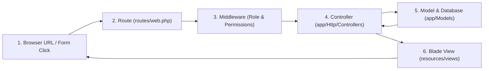

# Tshaprint Solutions: Independent Developer & Debugging Handbook

This guide is designed to empower you to navigate, understand, build, and debug your Laravel ERP & POS system independently in **VS Code**.

---

## 1. The Laravel Mental Model: The "Chain of Custody"

Whenever a user clicks a button, loads a page, or submits a form in your browser, Laravel processes the request through an orderly **5-link chain**:



| Step | Component | Location in VS Code | What Happens Here |
|:---|:---|:---|:---|
| **1. Route** | Routing File | [`routes/web.php`](file:///c:/Development/Laravel/uniform-shop-erp/routes/web.php) | Matches the URL (e.g. `/adjustments/edit-stock`) to a Controller method. |
| **2. Security** | Middleware / Gate | Route file or Controller | Verifies: Is user logged in? Do they have the required role or permission? |
| **3. Logic** | Controller | [`app/Http/Controllers/`](file:///c:/Development/Laravel/uniform-shop-erp/app/Http/Controllers/) | Takes input, queries database, validates data, decides what to display. |
| **4. Database** | Eloquent Model | [`app/Models/`](file:///c:/Development/Laravel/uniform-shop-erp/app/Models/) | Communicates with MySQL tables (e.g., [`ProductVariant.php`](file:///c:/Development/Laravel/uniform-shop-erp/app/Models/ProductVariant.php)). |
| **5. Display** | Blade Template | [`resources/views/`](file:///c:/Development/Laravel/uniform-shop-erp/resources/views/) | HTML, Tailwind styling, buttons, forms, and tables shown to the user. |

---

## 2. Navigating Like a Pro in VS Code

You do not need to hunt through folder trees manually. Learn these **4 essential shortcuts**:

1. **Quick Open File (`Ctrl + P`)**:
   - Press `Ctrl + P`, then type a few letters of the file name:
     - `web` &rarr; opens `routes/web.php`
     - `StockAdj` &rarr; opens `StockAdjustmentController.php`
     - `side` &rarr; opens `sidebar.blade.php`
     - `edit_st` &rarr; opens `edit_stock.blade.php`
2. **Global Codebase Search (`Ctrl + Shift + F`)**:
   - Searches every file in the project.
   - *Example*: If you see text on screen like *"Product Pricing & Size Tier Management"* and want to find where it lives, press `Ctrl + Shift + F`, paste that sentence, and VS Code jumps directly to the file and line.
3. **Toggle Integrated Terminal (`Ctrl + \`` or ``Ctrl + ~``)**:
   - Opens the PowerShell terminal right inside VS Code.
   - Run artisan commands (`php artisan ...`) without switching windows.
4. **Jump to Definition (`F12` or `Ctrl + Click`)**:
   - In any PHP file, hover over a Model name (e.g., `ProductVariant`) or a method name and press `F12` to jump directly to its code.

---

## 3. Step-by-Step Blueprints for Common Tasks

### Blueprint A: How to Add a New Page / Feature (e.g., "Edit Stock")

When you want to add a new page to the system, follow these 5 steps in order:

#### Step 1: Check the Database Model (`app/Models/`)
If the page updates database fields, make sure the column is listed in `$fillable`.
- Open the model (e.g., [`app/Models/ProductVariant.php`](file:///c:/Development/Laravel/uniform-shop-erp/app/Models/ProductVariant.php)).
- Ensure your field is listed:
  ```php
  protected $fillable = [
      'product_id',
      'sku',
      'selling_price',
      'stock_quantity', // <-- Must be here for Mass Assignment
  ];
  ```

#### Step 2: Write the Controller Logic (`app/Http/Controllers/`)
- Open the relevant controller (e.g., [`StockAdjustmentController.php`](file:///c:/Development/Laravel/uniform-shop-erp/app/Http/Controllers/StockAdjustmentController.php)).
- Add your method:
  ```php
  public function editStock(Request $request)
  {
      // 1. Permission check
      $this->checkOwnerOrAdmin();

      // 2. Fetch data from DB
      $variants = ProductVariant::with('product.category')->paginate(30);

      // 3. Return view with data
      return view('adjustments.edit_stock', compact('variants'));
  }
  ```

#### Step 3: Register the Route (`routes/web.php`)
- Open [`routes/web.php`](file:///c:/Development/Laravel/uniform-shop-erp/routes/web.php).
- **CRITICAL RULE on Route Ordering**:
  Always place specific routes **before** resource routes.
  ```php
  // CORRECT:
  Route::get('/adjustments/edit-stock', [StockAdjustmentController::class, 'editStock'])->name('adjustments.edit-stock');
  Route::resource('adjustments', StockAdjustmentController::class);

  // WRONG:
  // Route::resource('adjustments', ...);
  // Route::get('/adjustments/edit-stock', ...); <-- Laravel will mistake "edit-stock" for an adjustment ID!
  ```

#### Step 4: Create the Blade View (`resources/views/`)
- In VS Code, right-click the folder (e.g., `resources/views/adjustments/`) &rarr; **New File** &rarr; `edit_stock.blade.php`.
- Wrap your page inside the master layout:
  ```html
  <x-app-layout>
      <x-slot name="header">
          <h2>Page Title</h2>
      </x-slot>

      <div class="py-6">
          <!-- Your forms, tables, and buttons -->
      </div>
  </x-app-layout>
  ```

#### Step 5: Add Navigation Link in the Sidebar (`resources/views/layouts/sidebar.blade.php`)
- Open [`resources/views/layouts/sidebar.blade.php`](file:///c:/Development/Laravel/uniform-shop-erp/resources/views/layouts/sidebar.blade.php).
- Locate the matching section (e.g. Stock Adjustment) and add your link:
  ```html
  <a href="{{ route('adjustments.edit-stock') }}" class="block py-1 px-2 rounded hover:bg-slate-800 {{ request()->routeIs('adjustments.edit-stock') ? 'text-indigo-400 font-bold' : 'text-slate-400' }}">
      Edit Stock Quantities
  </a>
  ```

---

### Blueprint B: How to Add a Delete Button with Safe Authorization

When you want to add a delete button (e.g., delete user or delete item):

1. **Controller Method** ([`UserController.php`](file:///c:/Development/Laravel/uniform-shop-erp/app/Http/Controllers/UserController.php)):
   ```php
   public function destroy(User $user)
   {
       // Safety check: Cannot delete own account
       if (auth()->id() === $user->id) {
           return back()->with('error', 'You cannot delete your own active account.');
       }
       // Safety check: Cannot delete system owner
       if ($user->hasRole('owner')) {
           return back()->with('error', 'The primary owner account cannot be deleted.');
       }

       $user->delete();
       return redirect()->route('users.index')->with('success', 'User removed successfully.');
   }
   ```
2. **Route** ([`routes/web.php`](file:///c:/Development/Laravel/uniform-shop-erp/routes/web.php)):
   ```php
   Route::delete('/users/{user}', [UserController::class, 'destroy'])
       ->name('users.destroy')
       ->middleware('permission:delete-users');
   ```
3. **Blade Button** ([`resources/views/users/index.blade.php`](file:///c:/Development/Laravel/uniform-shop-erp/resources/views/users/index.blade.php)):
   ```html
   <!-- In HTML, DELETE requests must be sent inside a mini-form with @csrf and @method('DELETE') -->
   <form method="POST" action="{{ route('users.destroy', $user) }}" onsubmit="return confirm('Are you sure you want to delete this user?');" class="inline">
       @csrf
       @method('DELETE')
       <button type="submit" style="color: #dc2626 !important; font-weight: bold;">
           Delete
       </button>
   </form>
   ```

---

## 4. The Debugger's Toolkit: How to Diagnose and Fix Any Error

### Error 1: "500 Server Error" (The Dreaded Blank / Generic Screen)
When Railway, Apache, or your local server says **500 Server Error**, it is intentionally hiding the real error for security reasons.

**Where to look in VS Code**:
1. Open the file: [`storage/logs/laravel.log`](file:///c:/Development/Laravel/uniform-shop-erp/storage/logs/laravel.log).
2. Press `Ctrl + End` to jump to the **very bottom** of the file.
3. Look at the last entry:
   - It will tell you the **exact file** and the **exact line number**!
   - *Example*: `SQLSTATE[42S22]: Column not found: 1054 Unknown column 'abc' in 'field list' in C:\Development\...\StockController.php:45`
   - You now know immediately: go to line 45 in that controller and fix the column name!

---

### Error 2: "403 Forbidden" or "You do not have permission to access page"
This means Laravel blocked the user before the controller was even reached.

**Where to check**:
1. Open [`routes/web.php`](file:///c:/Development/Laravel/uniform-shop-erp/routes/web.php).
2. Check the `->middleware('permission:some-permission')` attached to the route.
3. Open database table `roles` and `role_has_permissions`. Does the logged-in user's role have that permission checkbox ticked?
4. Open the Controller and check for custom guards like `$this->checkOwnerOrAdmin()`.

---

### Error 3: "Buttons Disappear" or "Colors Don't Show / Text is Invisible"
This is a classic trap in Tailwind CSS applications.

**Why it happens**:
When Tailwind compiles assets (`npm run build`), it scans your Blade files and only compiles the CSS classes that were present at build time. If you write a new class in Blade later (e.g., `bg-amber-600` or `bg-rose-600`) without running `npm run build`, Tailwind has no CSS for it, so it renders **transparent** (white text on a transparent background becomes invisible!).

**How to detect it using Browser DevTools (F12)**:
1. In your browser (Chrome or Edge), right-click the invisible area &rarr; click **Inspect Element** (or press `F12`).
2. Look at the Elements panel: is the button tag actually in the HTML? If yes, look at the **Styles** panel on the right. If background color is empty or crossed out, Tailwind missed that class.

**How to fix**:
- **Fix Option 1 (Bulletproof Inline Style)**: Add explicit styling to critical action buttons:
  ```html
  <button style="background-color: #2563eb !important; color: #ffffff !important;">Save</button>
  ```
- **Fix Option 2 (Recompile Assets)**: Run in terminal:
  ```powershell
  npm run build
  ```

---

### Error 4: "Undefined variable $abc (View: ...)"
This occurs when your Blade view expects a variable that the Controller forgot to send.

**How to fix**:
1. Check the controller method returning the view:
   ```php
   // Controller
   return view('my_view', compact('products', 'categories')); // <-- Did you forget to include $categories here?
   ```
2. Or in the Blade file, make your variable check defensive:
   ```html
   <!-- Risky: -->
   @if($errors->any())

   <!-- Safe (works even if variable is not initialized): -->
   @if(isset($errors) && $errors->any())
   ```

---

## 5. Daily Terminal Commands Cheat Sheet

Run these in your VS Code terminal (`Ctrl + \``):

| Command | Purpose |
|:---|:---|
| `php artisan route:list --name=adjustments` | Shows all registered URLs, names, and controllers for adjustments. Run this to check if your new route exists. |
| `php artisan tinker` | Opens an interactive PHP shell. You can test queries directly: `ProductVariant::count();` or `User::first();`. Type `exit` to quit. |
| `php artisan cache:clear` | Clears application cache if route changes or config edits aren't showing up. |
| `php artisan view:clear` | Clears compiled Blade templates so fresh HTML is generated immediately. |
| `git status` | Shows which files were edited or created before making commits. |
| `git diff <file>` | Shows the exact line-by-line before/after changes in a file. |
